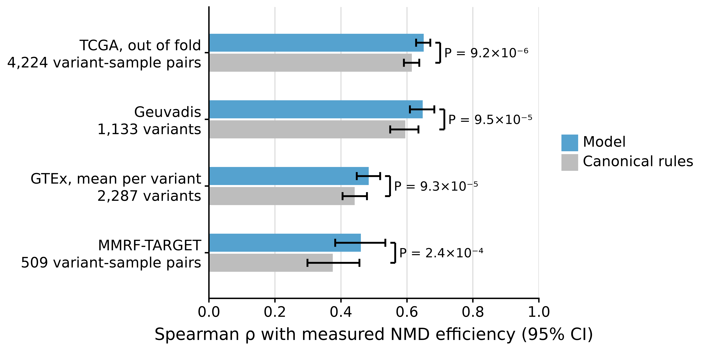

# NMD variant effect prediction

The NMD-Scanner is a Python-based variant effect annotation tool that predicts the likelihood of transcript degradation through nonsense-mediated decay (NMD).
It reconstructs reference and alternative coding sequences as well as transcript sequences in some cases, identifies premature termination codons (PTCs), and evaluates canonical and non-canonical NMD escape rules.
It can handle single-nucleotide variants, multiple base substitutions, long and short deletions and duplications as well as frameshift variants.

## Features

- Reads variants from VCF and gene annotations from GFF3 (GENCODE or Ensembl flavor), gzip-compressed or not
- Reconstructs reference and alternative CDS, reference transcript sequence and (in some cases) the alternative transcript sequences with metadata
- Detects start / stop-loss and premature termination codons (PTCs) with the exact position in the CDS and in which exon it lies
- Computes different NMD-related features:
  - Total, upstream and downstream exon count
  - Distance of PTC to original stop codon
  - Distance of PTC to start codon
  - Transcript length
  - 3' and 5' UTR lengths
- Evaluates five canonical NMD escape rules:
  - Last exon rule
  - 50nt penultimate rule
  - Long exon rule
  - Start-proximal rule
  - Single-exon rule
- Predicts the NMD efficiency of each PTC with a random forest (see [NMD efficiency prediction](#nmd-efficiency-prediction))
- Writes the results as CSV or Parquet, or returns them as a pandas DataFrame

[Technical Notes](Technical%20Notes.md) defines the features and the NMD escape rules, with figures.

## Installation

Requires Python >= 3.12.

From [PyPI](https://pypi.org/project/nmd-scanner/):

```bash
pip install nmd-scanner
```

## Usage

### Option 1: Annotating a VCF on the command line

After the install, the `nmd-scanner` command is available:

```bash
nmd-scanner --vcf input.vcf --annotation annotation.gff3.gz --fasta reference.fa --output results/input.csv

# write Parquet instead of CSV
nmd-scanner --vcf input.vcf --annotation annotation.gff3.gz --fasta reference.fa --output results/input.parquet

# option: fix exon numbering (recommended for hg19)
nmd-scanner --vcf input.vcf --annotation annotation.gff3.gz --fasta reference.fa --output results/input.csv --reassign-exons

# option: leave out the 4 sequence columns
nmd-scanner --vcf input.vcf --annotation annotation.gff3.gz --fasta reference.fa --output results/input.parquet --no-sequences
```

Arguments:

- `--vcf`: Path to input VCF, plain or gzip-compressed, with one ALT allele per record. Split multi-allelic records first, e.g. with `bcftools norm -m-`. Records with a symbolic, breakend, `.` or `*` ALT are skipped with a warning.
- `--annotation`: Path to the gene annotation in GFF3 (GENCODE or Ensembl flavor), optionally gzip-compressed, with the suffix `.gff3` or `.gff`.
- `--fasta`: Path to reference genome FASTA.
- `--output`: Path to the output file. Extension selects the format: `.csv` for CSV, `.parquet` or `.pq` for Parquet.
- `--reassign-exons`: (flag) Recompute exon numbers (recommended for hg19)
- `--no-sequences`: (flag) Leave out the 4 sequence columns `ref_cds_seq`, `alt_cds_seq`, `transcript_seq` and `alt_transcript_seq`. These columns make up most of the output size.
- `--no-prediction`: (flag) Leave out the column `nmd_efficiency_prediction`, the prediction of the [NMD efficiency model](#nmd-efficiency-prediction).

The chromosome names must match in the VCF, the GFF3 and the FASTA, e.g. all `chr1` or all `1`.

Output:

- The file specified by `--output`, with one row per variant-transcript pair, containing:
  - `transcript_type` and `transcript_tags`: the type and the tags of the transcript, to filter by transcript
  - reconstructed reference / alternative CDS and transcript sequences (+ metadata); `--no-sequences` leaves out the sequences
  - PTC detection and start / stop-loss flags
  - NMD escape rules
  - extra features such as UTR lengths, exon counts, distances, etc.
  - `nmd_efficiency_prediction_status` and `nmd_efficiency_prediction`: whether the NMD efficiency model can predict the variant-transcript pair, and the NMD efficiency it predicts (see [NMD efficiency prediction](#nmd-efficiency-prediction))

[Output columns](Technical%20Notes.md#output-columns) in the Technical Notes gives the meaning of each column and says when it is null.

### Option 2: Import as a python module

`annotate` returns the result table of the CLI as a `pandas.DataFrame`; `sequences=False` and `prediction=False` are the flags `--no-sequences` and `--no-prediction`.

```python
import nmd_scanner

results = nmd_scanner.annotate("input.vcf", "annotation.gff3.gz", "reference.fa", reassign_exons=False)
nmd_scanner.write_results(results, "results.parquet")  # or "results.csv"
```

`annotate_variants` takes the tables of `read_vcf` and `read_annotation`, so one annotation serves many VCFs. The table of `read_vcf` has the output columns `chrom`, `start`, `end`, `variant_id`, `ref` and `alt` (see [Output columns](Technical%20Notes.md#output-columns)). A table from another source needs no `variant_id`.

The steps of `annotate` are public too; see [How `annotate` builds the result](Technical%20Notes.md#how-annotate-builds-the-result).

## NMD efficiency prediction

The CLI and `annotate` add the column `nmd_efficiency_prediction`, the prediction of a random forest that ships with the package. `--no-prediction` and `prediction=False` leave it out, and `nmd_scanner.add_nmd_efficiency_prediction(results)` adds it to a result of `add_features_and_rules`.

The model predicts `NMD_efficiency` of the NMDEff TCGA benchmark (Kim et al. 2024), about -log2(VAF_RNA / VAF_DNA). 0 means no NMD, and 1 means that the variant allele fraction in the RNA is half of that in the DNA. The prediction is null where `nmd_efficiency_prediction_status` is not `ok`. The model learned mostly from `protein_coding` transcripts tagged `Ensembl_canonical`. To keep only those, filter on `transcript_type` and `transcript_tags`.

## Model validation

The figure gives the Spearman correlation of the prediction with the measured NMD efficiency, with 95% CIs from a bootstrap over genes. "Canonical rules" ranks the same measurements by `nmd_escape` alone. [scripts/README.md](scripts/README.md) shows how to reproduce the figures.

| Cohort                                                                                 | Variant origin     |
| -------------------------------------------------------------------------------------- | ------------------ |
| TCGA (Kim et al. 2024), out of fold, folds grouped by chromosome                       | somatic, in tumors |
| Geuvadis (Iha et al. 2025), lymphoblastoid cell lines, the study's accurate annotation | germline           |
| GTEx v8 (Kim et al. 2024), 54 tissues, mean per variant                                | germline           |
| MMRF-TARGET (Kim et al. 2024)                                                          | somatic, in tumors |



The level of the measured efficiency differs between cohorts and tissues. To compare the predictions with another cohort's measurements, it is necessary to recalibrate them with a linear fit.

## License

All source code in this repository is licensed under the [MIT License](https://github.com/gagneurlab/NMD-Scanner/blob/main/LICENSE).

## Citation

Schröder, C.H. (2025). _Enhanced Aberrant Gene Expression Prediction across Human Tissues_.
Master's Thesis, Technical University of Munich / Ludwig-Maximilians-Universität München.
